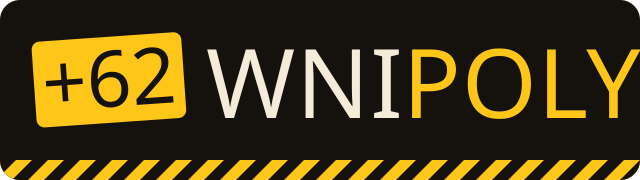
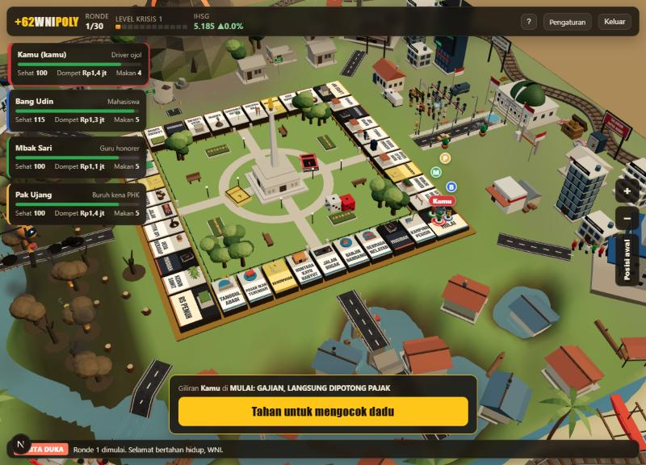
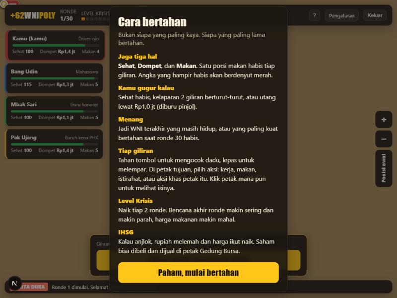
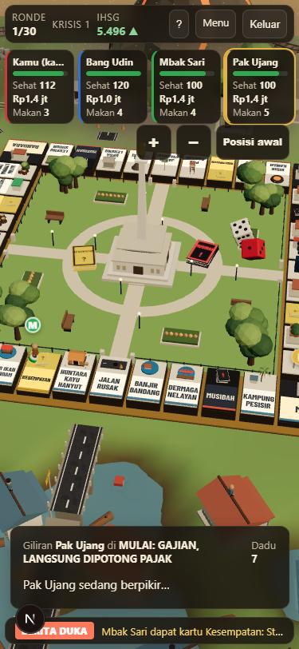
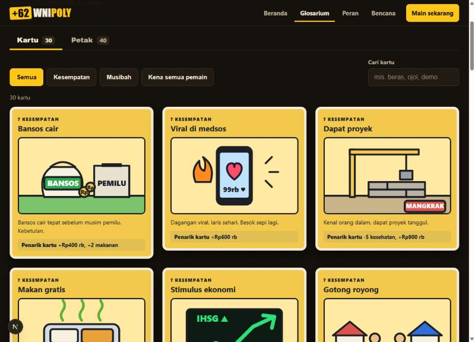
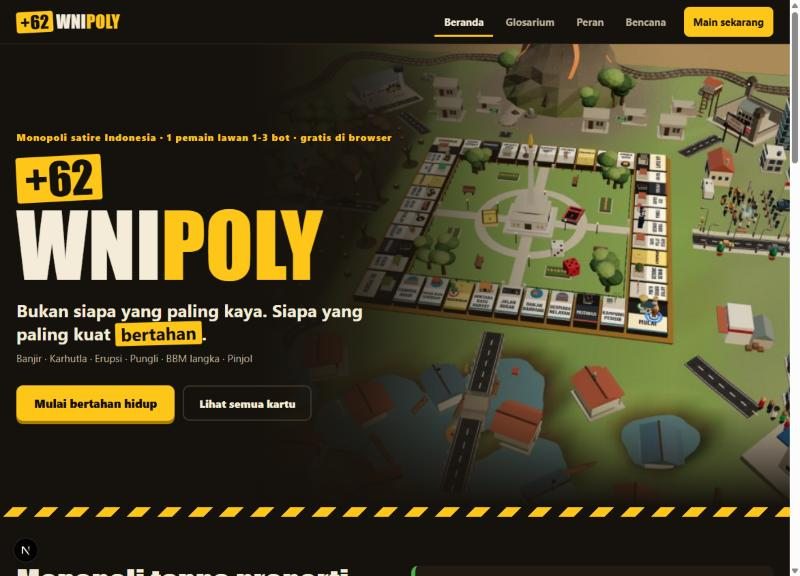
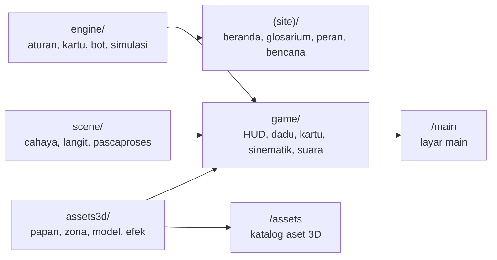

<p align="center">
  
</p>

<h3 align="center">Bukan siapa yang paling kaya. Siapa yang paling kuat bertahan jadi WNI.</h3>

<p align="center">
  Monopoli satire Indonesia dalam 3D. Gratis, langsung main di browser, desktop maupun HP.
</p>

<p align="center">
  <a href="https://wnipoly.vercel.app"></a>
</p>

<p align="center">
  
  
  
  
  
  
</p>

<p align="center">
  <a href="#tentang">Tentang</a> ·
  <a href="#cara-main">Cara main</a> ·
  <a href="#fitur">Fitur</a> ·
  <a href="#teknologi">Teknologi</a> ·
  <a href="#menjalankan-sendiri">Menjalankan sendiri</a> ·
  <a href="#kredit">Kredit</a>
</p>

<br>



## Tentang

+62WNIPOLY adalah game papan 3D bergaya Monopoli, tanpa hotel dan tanpa properti. Kamu warga biasa: gaji langsung dipotong pajak, harga beras naik tiap ronde, dan bencana datang bergiliran ke empat penjuru papan. **Pemenangnya bukan yang paling kaya, tapi yang paling lama bertahan hidup.**

Setiap kartu menyindir kejadian yang benar terjadi di Indonesia, lengkap dengan fakta singkat dan tautan sumber beritanya.

| | |
|---|---|
| **Pemain** | 1 orang melawan 1-3 bot, tiga tingkat kesulitan |
| **Lama main** | Paling lama 30 ronde |
| **Perangkat** | Browser desktop dan HP, tanpa instalasi, tanpa akun |
| **Bahasa** | Indonesia |

## Cara main



**Jaga tiga hal:** Sehat, Dompet, dan Makan. Satu porsi makan habis tiap giliran.

**Kamu gugur kalau** sehat habis, kelaparan 2 giliran berturut-turut, atau utang lewat Rp1 juta (diburu pinjol).

**Menang:** jadi WNI terakhir yang masih hidup, atau yang paling kuat bertahan saat ronde 30 habis.

**Tiap giliran:** tahan tombol untuk mengocok dadu, lepas untuk melempar, lalu pilih aksi di petak tujuan: kerja, makan, istirahat, atau aksi khas petak itu.

**Level Krisis** naik tiap 2 ronde. Bencana makin sering dan makin parah, harga makin mahal.

<br clear="right">

| Tombol | Fungsi |
|---|---|
| Tahan `Spasi`, lepas | Kocok dan lempar dadu |
| `Enter` | Lempar cepat |
| `1` - `9` | Pilih aksi |
| `+` &nbsp;`-` &nbsp;`0` | Perbesar, perkecil, kembali ke posisi kamera awal |
| Klik petak | Lihat isi petak dan siapa yang berdiri di sana |

## Fitur

| | |
|---|---|
| **Empat zona, empat bencana** | Pesisir banjir di selatan, hutan terbakar di barat, gunung meletus di utara, pusat kekuasaan di timur. Air naik merendam dunia sampai papan tersisa seperti pulau, lahar merambat ke lapangan Monas, konvoi polisi mengawal mobil pejabat. |
| **30 kartu satire bersumber** | Kesempatan (kuning) dan Musibah (hitam). Sebagian menimpa semua pemain, sebagian paling keras ke satu profesi: BBM langka menyiksa ojol, gaji honorer ditahan menyiksa guru. |
| **Enam peran** | Buruh kena PHK, driver ojol, guru honorer, petani, mahasiswa, pedagang pasar. Masing-masing punya kelebihan dan beban sendiri. |
| **Rasa main** | Dadu berfisika yang saling tabrak, kartu terbang keluar dari dek di papan, kurungan jatuh saat masuk Lapas VIP, polisi muncul di petak Pungli. |
| **Bot dan mesin aturan** | Aturan deterministik dengan RNG ber-seed, diuji simulasi ratusan permainan agar tiap peran punya peluang adil. |
| **Ramah HP** | Tata letak khusus layar sempit, kualitas grafis menyesuaikan perangkat dan turun otomatis saat fps jatuh. |

<p align="center">
  
  &nbsp;&nbsp;
  
</p>

Situsnya juga punya halaman **Glosarium** (semua kartu dan 40 petak), **Peran**, dan **Bencana**.



## Teknologi

| Lapisan | Teknologi | Dipakai untuk |
|---|---|---|
| Kerangka web | [Next.js 16](https://nextjs.org) (App Router), [React 19](https://react.dev), [TypeScript 7](https://www.typescriptlang.org) | Situs statis, halaman game, katalog aset |
| Grafis 3D | [Three.js r186](https://threejs.org), [react-three-fiber 9](https://github.com/pmndrs/react-three-fiber), [drei 10](https://github.com/pmndrs/drei) | Dunia, papan, kamera, monitor performa |
| Efek visual | [postprocessing](https://github.com/pmndrs/postprocessing) | Bloom, oklusi ambien (N8AO), tone mapping ACES, SMAA |
| Teks 3D | [troika-three-text](https://github.com/protectwise/troika) | Judul petak tajam (SDF) dari jarak dan sudut berapa pun |
| Model 3D | glTF dari [KayKit](https://kaylousberg.com) dan [Kenney](https://kenney.nl) (CC0) | Mobil, gedung kota, perabot jalan, kereta; atlas warnanya diredupkan agar senada |
| Aset prosedural | Geometri Three.js buatan sendiri | Monas, gedung dewan, gunung, banjir, lahar, asap, dadu, kartu |
| Suara | Web Audio API | Efek suara disintesis tanpa file audio; musik latar berupa tiga lagu CC0 yang berganti sesuai Level Krisis |
| Tes | [Vitest 5](https://vitest.dev) | 186 tes: aturan, simulasi keseimbangan, aset |
| Hosting | [Vercel](https://vercel.com) | Deploy otomatis tiap push ke `main` |

### Arsitektur



Mesin aturan (`src/engine`) murni tanpa React atau Three.js: `applyAction(state, action)` selalu menghasilkan keadaan baru, jadi bisa dipakai bersama oleh bot, tes, dan kelak mode online.

## Menjalankan sendiri

Butuh [Node.js](https://nodejs.org) 20.9 atau lebih baru.

```bash
npm install
```

```bash
npm run dev
```

Buka `http://localhost:3000`. Halaman lain: `/main` langsung ke layar pilih peran, `/assets` katalog semua aset 3D.

| Perintah | Fungsi |
|---|---|
| `npm run dev` | Server pengembangan |
| `npm test` | Jalankan semua tes |
| `npm run build` | Build produksi |
| `npm start` | Jalankan hasil build |

### Struktur proyek

```
src/
  engine/     mesin aturan murni: petak, kartu, peran, bot, simulasi keseimbangan
  game/       layar main: HUD, dadu, kartu, sinematik bencana, suara
  assets3d/   dunia 3D: papan, zona, jalan, rel, model, efek
  scene/      cahaya, langit, dan pascaproses
  app/        situs (beranda, glosarium, peran, bencana), /main, /assets
public/
  models/     model 3D CC0 (KayKit, Kenney) beserta lisensinya
  fonts/      Barlow Condensed (OFL)
docs/         riset dan audit aset, logo, tangkapan layar
```

## Kredit

- Model 3D [KayKit City Builder Bits](https://kaylousberg.itch.io/city-builder-bits) dan KayKit Medieval Hexagon oleh Kay Lousberg, lisensi CC0.
- [Kenney Train Kit](https://kenney.nl/assets/train-kit) oleh Kenney, lisensi CC0.
- Musik latar (CC0): [Chill lofi inspired](https://opengameart.org/content/chill-lofi-inspired-loop-edit) oleh omfgdude (loop oleh qubodup), [Cyber March](https://opengameart.org/content/cyber-march) oleh iamoneabe, dan [Drive](https://opengameart.org/content/drive-0) oleh Zane Little Music. Rincian di [public/music/CREDITS.txt](public/music/CREDITS.txt).
- Font [Barlow Condensed](https://github.com/jpt/barlow) oleh The Barlow Project Authors, SIL Open Font License 1.1.

Rincian sumber dan status tiap aset ada di [docs/riset-aset.md](docs/riset-aset.md).

## Catatan

+62WNIPOLY adalah karya satire. Semua tokoh di dalam game fiktif. Kejadian di kartu merujuk berita nyata, dan sumbernya tercantum di tiap kartu.
